# CodePilot AI - Software Architecture

## System Architecture Overview

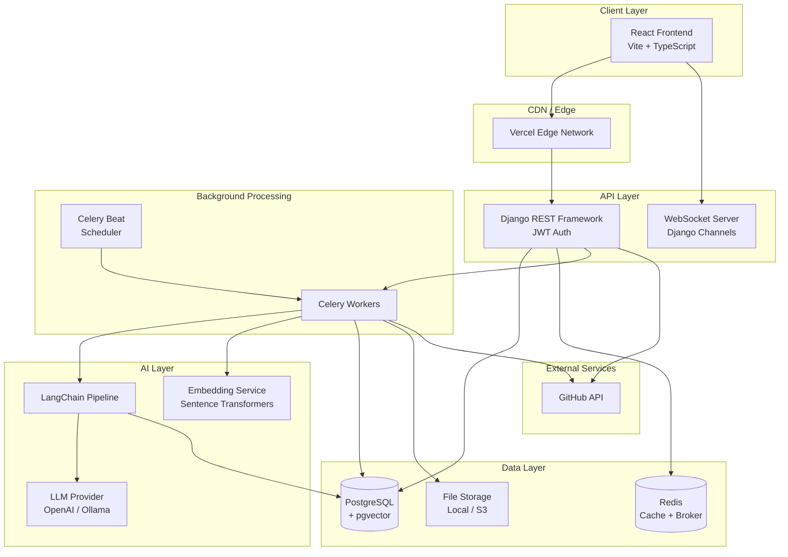

## Frontend Architecture

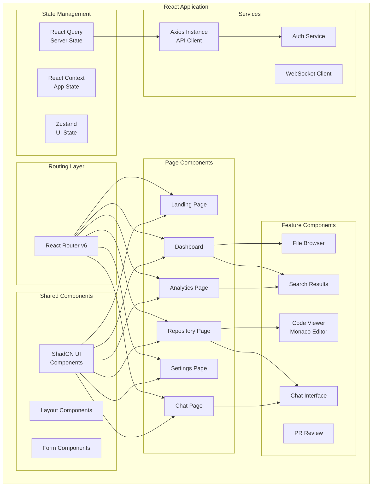

### Frontend Design Decisions
- **State Management**: React Query for server state (caching, sync), Zustand for UI state (sidebar, theme), React Context for auth
- **Code Splitting**: Route-level lazy loading for optimal bundle size
- **API Layer**: Centralized Axios instance with interceptors for auth, error handling, retry
- **Styling**: Tailwind CSS utility classes + ShadCN component library for consistency
- **Forms**: React Hook Form + Zod for validation

## Backend Architecture

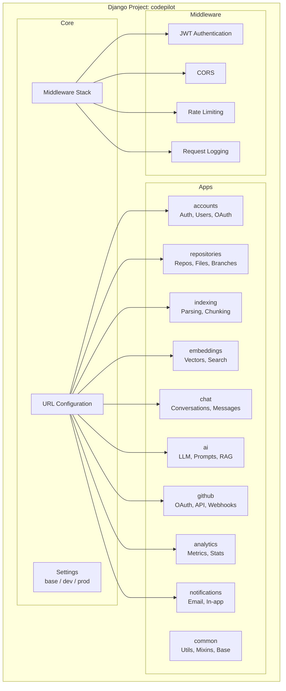

### Backend Design Decisions
- **App Separation**: Each Django app has a single responsibility, clear boundaries
- **Serializers**: Input validation and output formatting via DRF serializers
- **Permissions**: Custom permission classes per endpoint
- **Pagination**: Cursor-based pagination for large datasets
- **Versioning**: URL-based API versioning (v1/)
- **Error Handling**: Centralized exception handler with consistent error format

## Database Architecture

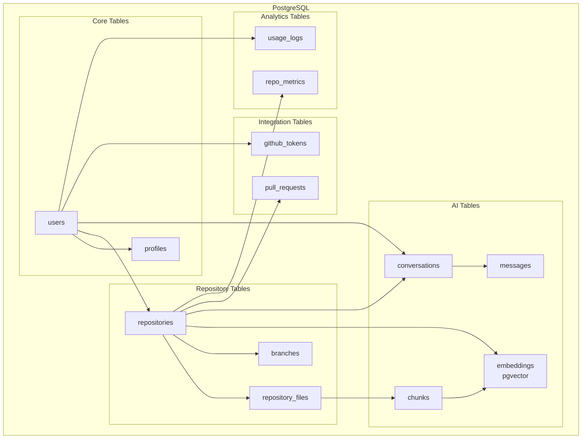

## Authentication Architecture

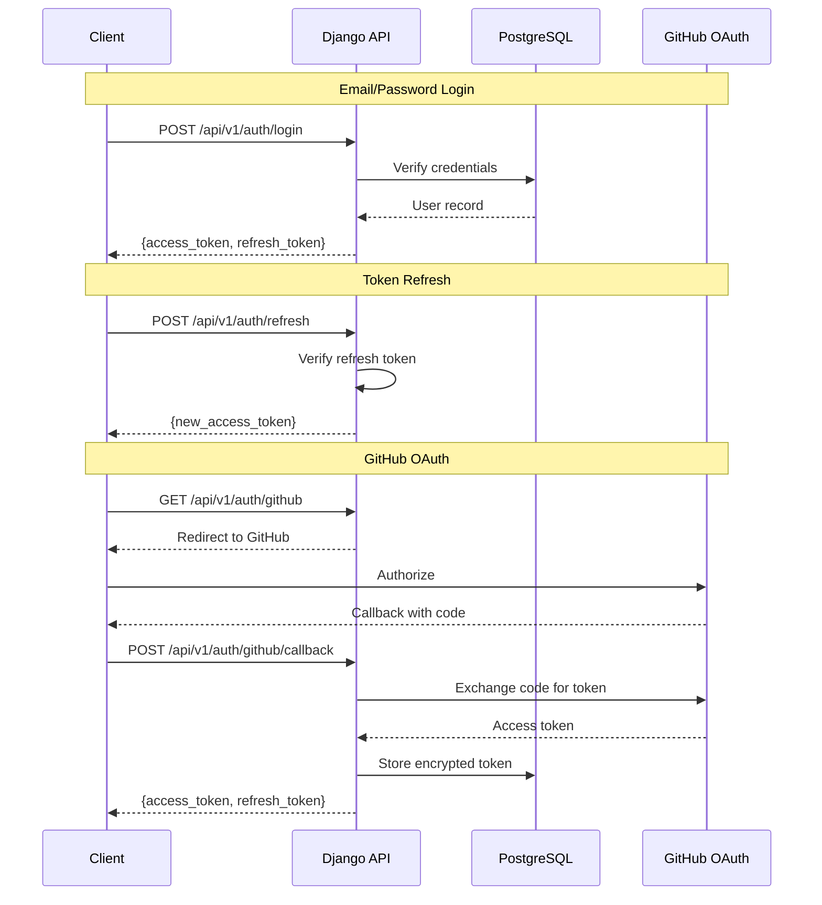

## AI Pipeline Architecture

```mermaid
graph TB
    subgraph "Query Pipeline"
        UQ[User Query]
        QE[Query Embedding]
        VS[Vector Search<br/>pgvector]
        CTX[Context Assembly]
        PM[Prompt Construction]
        LLM[LLM Inference]
        RS[Response Stream]
    end

    subgraph "Indexing Pipeline"
        RI[Repository Import]
        FP[File Parser]
        CK[Code Chunker]
        ME[Metadata Extractor]
        EG[Embedding Generator]
        ST[Vector Storage]
    end

    UQ --> QE --> VS --> CTX --> PM --> LLM --> RS

    RI --> FP --> CK --> ME --> EG --> ST
```

## RAG Pipeline

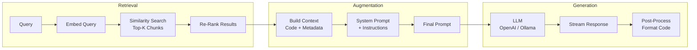

## Repository Indexing Pipeline

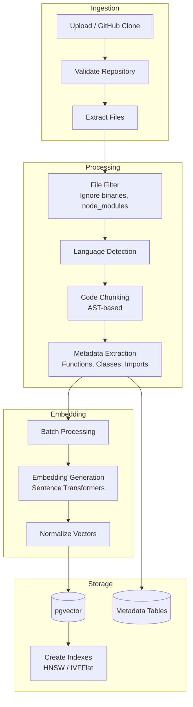

## Background Task Pipeline

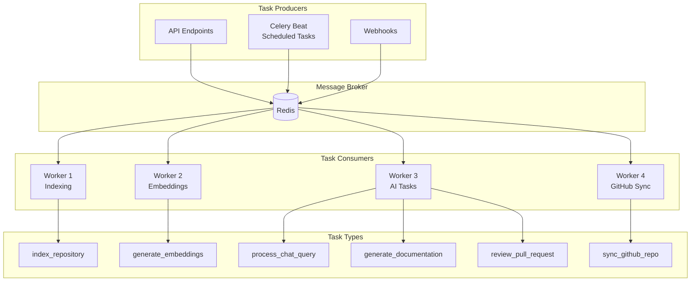

## GitHub Integration Architecture

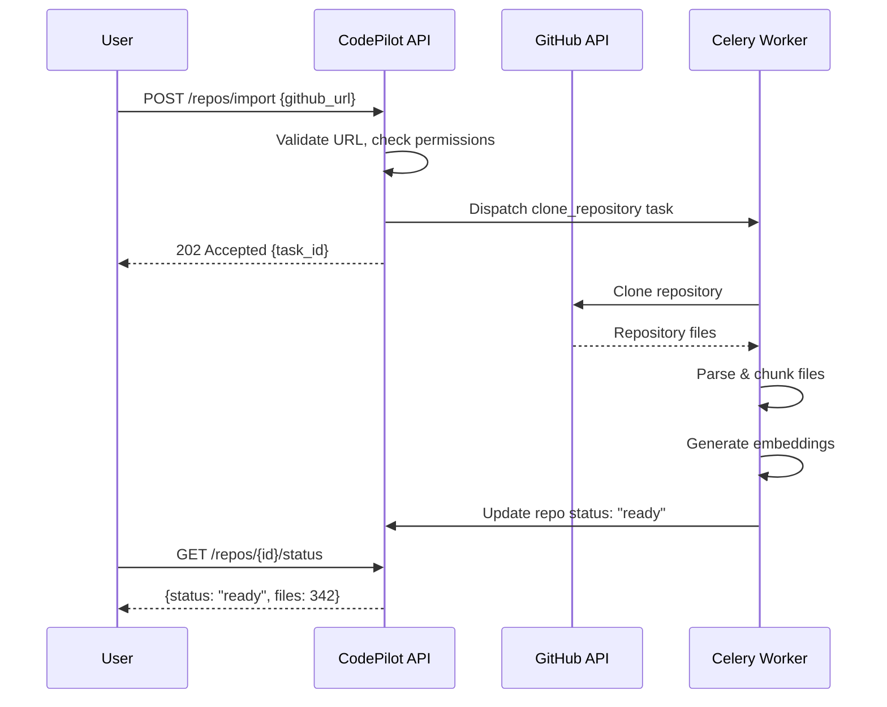

## Deployment Architecture

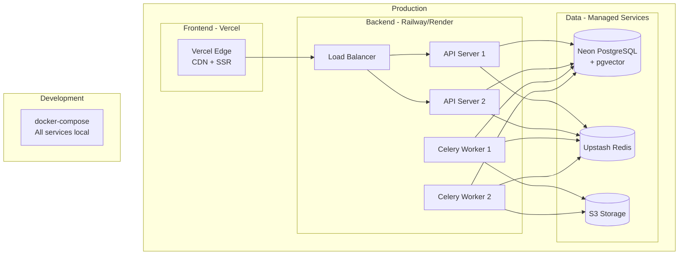

## Component Communication

| From | To | Protocol | Purpose |
|---|---|---|---|
| Frontend | API | HTTPS REST | All CRUD operations |
| Frontend | API | WebSocket | Chat streaming, notifications |
| API | PostgreSQL | TCP | Data persistence |
| API | Redis | TCP | Caching, session store |
| API | Celery | Redis (AMQP) | Task dispatching |
| Celery | PostgreSQL | TCP | Read/write data |
| Celery | GitHub API | HTTPS | Clone repos, fetch PRs |
| Celery | LLM Provider | HTTPS | AI inference |
| Celery | Sentence Transformers | Local | Embedding generation |
