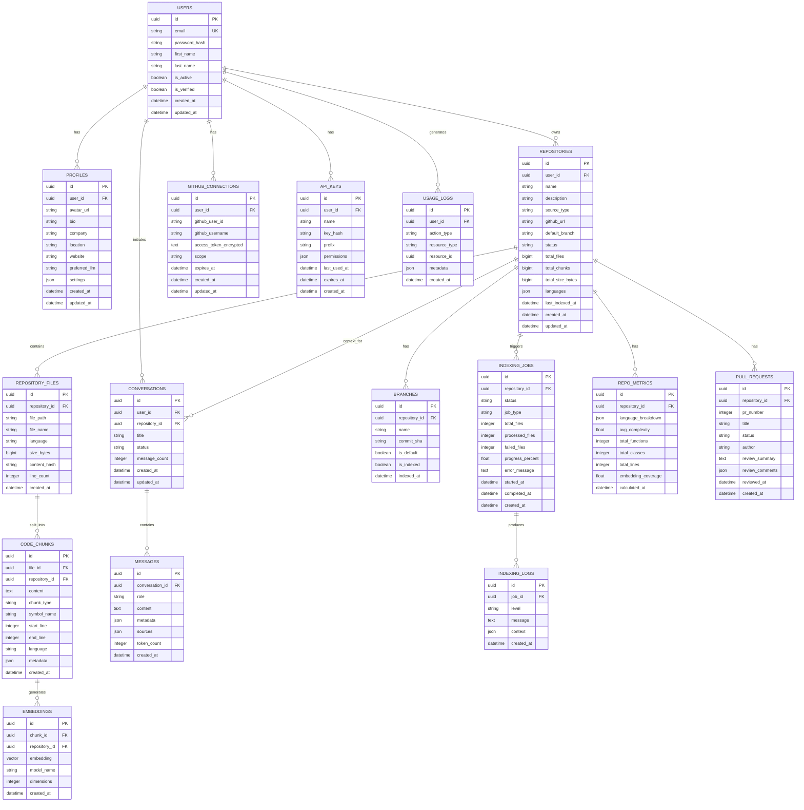

# CodePilot AI - Database Design

## ER Diagram



## Table Definitions

### users
Primary authentication table.

| Column | Type | Constraints | Description |
|---|---|---|---|
| id | UUID | PK, DEFAULT uuid_generate_v4() | Unique identifier |
| email | VARCHAR(255) | UNIQUE, NOT NULL | Login email |
| password_hash | VARCHAR(255) | NOT NULL | Bcrypt hashed password |
| first_name | VARCHAR(100) | NOT NULL | First name |
| last_name | VARCHAR(100) | NOT NULL | Last name |
| is_active | BOOLEAN | DEFAULT TRUE | Account active status |
| is_verified | BOOLEAN | DEFAULT FALSE | Email verified |
| is_staff | BOOLEAN | DEFAULT FALSE | Admin access |
| last_login | TIMESTAMPTZ | NULL | Last login timestamp |
| created_at | TIMESTAMPTZ | DEFAULT NOW() | Creation timestamp |
| updated_at | TIMESTAMPTZ | DEFAULT NOW() | Last update |

### profiles
Extended user information.

| Column | Type | Constraints | Description |
|---|---|---|---|
| id | UUID | PK | Unique identifier |
| user_id | UUID | FK(users.id), UNIQUE | One-to-one with user |
| avatar_url | VARCHAR(500) | NULL | Profile image URL |
| bio | TEXT | NULL | User biography |
| company | VARCHAR(200) | NULL | Company name |
| location | VARCHAR(200) | NULL | Location |
| website | VARCHAR(500) | NULL | Personal website |
| preferred_llm | VARCHAR(50) | DEFAULT 'openai' | Preferred AI provider |
| settings | JSONB | DEFAULT '{}' | User preferences |
| created_at | TIMESTAMPTZ | DEFAULT NOW() | Creation timestamp |
| updated_at | TIMESTAMPTZ | DEFAULT NOW() | Last update |

### repositories
Core repository metadata.

| Column | Type | Constraints | Description |
|---|---|---|---|
| id | UUID | PK | Unique identifier |
| user_id | UUID | FK(users.id), NOT NULL | Owner |
| name | VARCHAR(255) | NOT NULL | Repository name |
| description | TEXT | NULL | Description |
| source_type | VARCHAR(20) | NOT NULL | 'github' or 'upload' |
| github_url | VARCHAR(500) | NULL | GitHub repository URL |
| default_branch | VARCHAR(100) | DEFAULT 'main' | Default branch |
| status | VARCHAR(20) | NOT NULL, DEFAULT 'pending' | pending/indexing/ready/failed |
| total_files | BIGINT | DEFAULT 0 | File count |
| total_chunks | BIGINT | DEFAULT 0 | Chunk count |
| total_size_bytes | BIGINT | DEFAULT 0 | Total size |
| languages | JSONB | DEFAULT '{}' | Language breakdown |
| last_indexed_at | TIMESTAMPTZ | NULL | Last indexing time |
| created_at | TIMESTAMPTZ | DEFAULT NOW() | Creation timestamp |
| updated_at | TIMESTAMPTZ | DEFAULT NOW() | Last update |

### repository_files
Individual files within a repository.

| Column | Type | Constraints | Description |
|---|---|---|---|
| id | UUID | PK | Unique identifier |
| repository_id | UUID | FK(repositories.id), NOT NULL | Parent repository |
| file_path | VARCHAR(1000) | NOT NULL | Full file path |
| file_name | VARCHAR(255) | NOT NULL | File name only |
| language | VARCHAR(50) | NULL | Detected language |
| size_bytes | BIGINT | NOT NULL | File size |
| content_hash | VARCHAR(64) | NOT NULL | SHA-256 of content |
| line_count | INTEGER | DEFAULT 0 | Number of lines |
| created_at | TIMESTAMPTZ | DEFAULT NOW() | Creation timestamp |

### code_chunks
Code segments extracted from files.

| Column | Type | Constraints | Description |
|---|---|---|---|
| id | UUID | PK | Unique identifier |
| file_id | UUID | FK(repository_files.id) | Source file |
| repository_id | UUID | FK(repositories.id) | Parent repository (denormalized for perf) |
| content | TEXT | NOT NULL | Chunk content |
| chunk_type | VARCHAR(50) | NOT NULL | function/class/module/block |
| symbol_name | VARCHAR(255) | NULL | Function/class name |
| start_line | INTEGER | NOT NULL | Start line number |
| end_line | INTEGER | NOT NULL | End line number |
| language | VARCHAR(50) | NULL | Language |
| metadata | JSONB | DEFAULT '{}' | Additional metadata |
| created_at | TIMESTAMPTZ | DEFAULT NOW() | Creation timestamp |

### embeddings
Vector embeddings for code chunks.

| Column | Type | Constraints | Description |
|---|---|---|---|
| id | UUID | PK | Unique identifier |
| chunk_id | UUID | FK(code_chunks.id), UNIQUE | Source chunk |
| repository_id | UUID | FK(repositories.id) | Repository (denormalized) |
| embedding | VECTOR(384) | NOT NULL | Embedding vector |
| model_name | VARCHAR(100) | NOT NULL | Model used |
| dimensions | INTEGER | NOT NULL | Vector dimensions |
| created_at | TIMESTAMPTZ | DEFAULT NOW() | Creation timestamp |

### conversations
Chat conversations.

| Column | Type | Constraints | Description |
|---|---|---|---|
| id | UUID | PK | Unique identifier |
| user_id | UUID | FK(users.id), NOT NULL | Conversation owner |
| repository_id | UUID | FK(repositories.id), NULL | Repository context |
| title | VARCHAR(255) | NULL | Auto-generated title |
| status | VARCHAR(20) | DEFAULT 'active' | active/archived |
| message_count | INTEGER | DEFAULT 0 | Message count |
| created_at | TIMESTAMPTZ | DEFAULT NOW() | Creation timestamp |
| updated_at | TIMESTAMPTZ | DEFAULT NOW() | Last update |

### messages
Individual chat messages.

| Column | Type | Constraints | Description |
|---|---|---|---|
| id | UUID | PK | Unique identifier |
| conversation_id | UUID | FK(conversations.id), NOT NULL | Parent conversation |
| role | VARCHAR(20) | NOT NULL | 'user' or 'assistant' |
| content | TEXT | NOT NULL | Message content |
| metadata | JSONB | DEFAULT '{}' | Model info, timing |
| sources | JSONB | DEFAULT '[]' | Referenced code chunks |
| token_count | INTEGER | DEFAULT 0 | Token usage |
| created_at | TIMESTAMPTZ | DEFAULT NOW() | Creation timestamp |

### github_connections
GitHub OAuth credentials.

| Column | Type | Constraints | Description |
|---|---|---|---|
| id | UUID | PK | Unique identifier |
| user_id | UUID | FK(users.id), UNIQUE | Owner |
| github_user_id | VARCHAR(50) | NOT NULL | GitHub user ID |
| github_username | VARCHAR(100) | NOT NULL | GitHub username |
| access_token_encrypted | TEXT | NOT NULL | Encrypted OAuth token |
| scope | VARCHAR(500) | NOT NULL | Granted scopes |
| expires_at | TIMESTAMPTZ | NULL | Token expiry |
| created_at | TIMESTAMPTZ | DEFAULT NOW() | Creation timestamp |
| updated_at | TIMESTAMPTZ | DEFAULT NOW() | Last update |

### indexing_jobs
Background indexing job tracking.

| Column | Type | Constraints | Description |
|---|---|---|---|
| id | UUID | PK | Unique identifier |
| repository_id | UUID | FK(repositories.id), NOT NULL | Target repository |
| status | VARCHAR(20) | NOT NULL | pending/running/completed/failed |
| job_type | VARCHAR(50) | NOT NULL | full/incremental/reindex |
| total_files | INTEGER | DEFAULT 0 | Total files to process |
| processed_files | INTEGER | DEFAULT 0 | Processed count |
| failed_files | INTEGER | DEFAULT 0 | Failed count |
| progress_percent | FLOAT | DEFAULT 0.0 | Completion percentage |
| error_message | TEXT | NULL | Error details |
| started_at | TIMESTAMPTZ | NULL | Job start time |
| completed_at | TIMESTAMPTZ | NULL | Job end time |
| created_at | TIMESTAMPTZ | DEFAULT NOW() | Creation timestamp |

## Indexes

```sql
-- Users
CREATE UNIQUE INDEX idx_users_email ON users(email);
CREATE INDEX idx_users_is_active ON users(is_active) WHERE is_active = true;

-- Repositories
CREATE INDEX idx_repositories_user_id ON repositories(user_id);
CREATE INDEX idx_repositories_status ON repositories(status);
CREATE INDEX idx_repositories_user_status ON repositories(user_id, status);

-- Repository Files
CREATE INDEX idx_repo_files_repository_id ON repository_files(repository_id);
CREATE INDEX idx_repo_files_language ON repository_files(repository_id, language);
CREATE INDEX idx_repo_files_path ON repository_files(repository_id, file_path);

-- Code Chunks
CREATE INDEX idx_chunks_file_id ON code_chunks(file_id);
CREATE INDEX idx_chunks_repository_id ON code_chunks(repository_id);
CREATE INDEX idx_chunks_type ON code_chunks(repository_id, chunk_type);
CREATE INDEX idx_chunks_symbol ON code_chunks(repository_id, symbol_name) WHERE symbol_name IS NOT NULL;

-- Embeddings (Vector Index - HNSW for fast approximate nearest neighbor)
CREATE INDEX idx_embeddings_vector ON embeddings
    USING hnsw (embedding vector_cosine_ops)
    WITH (m = 16, ef_construction = 64);
CREATE INDEX idx_embeddings_repository ON embeddings(repository_id);
CREATE INDEX idx_embeddings_chunk ON embeddings(chunk_id);

-- Conversations
CREATE INDEX idx_conversations_user ON conversations(user_id);
CREATE INDEX idx_conversations_repo ON conversations(repository_id);
CREATE INDEX idx_conversations_user_updated ON conversations(user_id, updated_at DESC);

-- Messages
CREATE INDEX idx_messages_conversation ON messages(conversation_id);
CREATE INDEX idx_messages_created ON messages(conversation_id, created_at);

-- Indexing Jobs
CREATE INDEX idx_indexing_jobs_repo ON indexing_jobs(repository_id);
CREATE INDEX idx_indexing_jobs_status ON indexing_jobs(status);

-- Usage Logs
CREATE INDEX idx_usage_logs_user ON usage_logs(user_id);
CREATE INDEX idx_usage_logs_created ON usage_logs(created_at);
CREATE INDEX idx_usage_logs_action ON usage_logs(action_type, created_at);
```

## Relationships

| Relationship | Type | Description |
|---|---|---|
| users → profiles | 1:1 | Each user has one profile |
| users → repositories | 1:N | User owns many repositories |
| users → conversations | 1:N | User has many conversations |
| users → github_connections | 1:1 | One GitHub connection per user |
| repositories → repository_files | 1:N | Repository contains many files |
| repositories → branches | 1:N | Repository has many branches |
| repositories → conversations | 1:N | Repository has many conversations |
| repository_files → code_chunks | 1:N | File split into many chunks |
| code_chunks → embeddings | 1:1 | Each chunk has one embedding |
| conversations → messages | 1:N | Conversation has many messages |
| repositories → indexing_jobs | 1:N | Repository has many index jobs |

## Normalization

The database follows **Third Normal Form (3NF)** with strategic denormalization:

### Denormalized Fields (Performance Optimization)
- `code_chunks.repository_id` — Avoids JOIN through repository_files for vector queries
- `embeddings.repository_id` — Enables direct repository-scoped vector search
- `repositories.total_files` / `total_chunks` — Counter cache to avoid COUNT queries
- `conversations.message_count` — Counter cache

### Justification
Vector similarity searches need to be scoped to a single repository. Without denormalized `repository_id` on embeddings, every search would require a JOIN chain: embeddings → chunks → files → repositories. The denormalization reduces query complexity from O(n*m) to O(n) for the most critical query path.

## Migration Strategy

1. **Initial Setup** — Enable pgvector extension, create all tables with proper constraints
2. **Incremental Migrations** — Django's migration framework for schema changes
3. **Data Migrations** — Separate from schema migrations, run in background
4. **Zero-Downtime** — Additive changes first, then backfill, then remove old columns
5. **Vector Index Tuning** — Start with IVFFlat, migrate to HNSW as data grows

### Migration Order
```
001_create_extensions (pgvector, uuid-ossp)
002_create_users
003_create_profiles
004_create_repositories
005_create_repository_files
006_create_branches
007_create_code_chunks
008_create_embeddings
009_create_conversations
010_create_messages
011_create_github_connections
012_create_indexing_jobs
013_create_indexing_logs
014_create_pull_requests
015_create_repo_metrics
016_create_api_keys
017_create_usage_logs
018_create_indexes
```

## Future Scalability

1. **Table Partitioning** — Partition `embeddings` and `code_chunks` by `repository_id` for large deployments
2. **Read Replicas** — Route analytics queries to read replicas
3. **Qdrant Migration** — Extract embeddings table to dedicated Qdrant instance when pgvector limits are reached
4. **Archival** — Move old conversations and usage logs to cold storage
5. **Sharding** — Shard by user_id if single-database limits are reached
