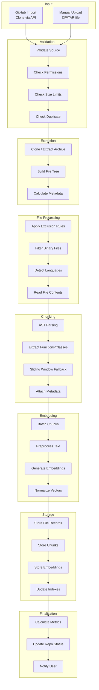

# CodePilot AI - Repository Ingestion Design

## Ingestion Flow



## Detailed Step-by-Step Process

### Step 1: User Initiates Import

**GitHub Import:**
```python
# User provides GitHub URL
POST /api/v1/repositories
{
    "source_type": "github",
    "github_url": "https://github.com/user/project",
    "branch": "main"
}
```

**Manual Upload:**
```python
# User uploads ZIP/TAR file
POST /api/v1/repositories (multipart/form-data)
{
    "source_type": "upload",
    "file": <binary>,
    "name": "my-project"
}
```

### Step 2: Validate

```python
def validate_repository_import(request_data):
    # 1. Source validation
    if source_type == "github":
        - Validate URL format (github.com/{owner}/{repo})
        - Check user has GitHub connection
        - Verify repo exists and user has access
        - Check if repo is already imported

    if source_type == "upload":
        - Validate file extension (.zip, .tar, .tar.gz)
        - Validate MIME type
        - Check file is not corrupted (attempt to read header)

    # 2. Size validation
    - GitHub: Check repo size via API (max 500MB)
    - Upload: Check file size (max 500MB compressed)

    # 3. Quota validation
    - Check user hasn't exceeded repository limit
    - Check concurrent indexing job limit

    # 4. Duplicate check
    - Check if same github_url already exists for user
    - If re-import, offer reindex instead
```

### Step 3: Extract

```python
def extract_repository(repo):
    if repo.source_type == "github":
        # Clone repository using GitHub API
        # Use sparse checkout for large repos
        # Clone specific branch only (--single-branch)
        clone_path = f"/tmp/repos/{repo.id}"
        git_clone(repo.github_url, clone_path, branch=repo.branch)

    elif repo.source_type == "upload":
        # Extract archive to temp directory
        extract_path = f"/tmp/repos/{repo.id}"
        extract_archive(repo.uploaded_file, extract_path)

    # Validate extracted content
    if not has_source_files(extract_path):
        raise ValidationError("No source files found")

    return extract_path
```

### Step 4: Read Files

```python
def build_file_manifest(repo_path):
    manifest = []

    for root, dirs, files in os.walk(repo_path):
        # Skip excluded directories (in-place modification)
        dirs[:] = [d for d in dirs if d not in EXCLUDED_DIRECTORIES]

        for filename in files:
            file_path = os.path.join(root, filename)
            relative_path = os.path.relpath(file_path, repo_path)

            # Skip excluded extensions
            if any(filename.endswith(ext) for ext in EXCLUDED_EXTENSIONS):
                continue

            # Skip files over size limit
            file_size = os.path.getsize(file_path)
            if file_size > MAX_FILE_SIZE:
                continue

            # Skip binary files (check first 8KB)
            if is_binary_file(file_path):
                continue

            manifest.append({
                "path": relative_path,
                "name": filename,
                "size": file_size,
                "language": detect_language(filename),
                "content_hash": compute_sha256(file_path)
            })

    return manifest
```

### Step 5: Ignore Binaries

```python
def is_binary_file(file_path):
    """
    Detect binary files using multiple heuristics:
    1. Check for null bytes in first 8KB
    2. Check if file is valid UTF-8
    3. Check against known binary extensions
    """
    try:
        with open(file_path, 'rb') as f:
            chunk = f.read(8192)

        # Null byte check
        if b'\x00' in chunk:
            return True

        # Try decoding as UTF-8
        try:
            chunk.decode('utf-8')
            return False
        except UnicodeDecodeError:
            return True

    except IOError:
        return True  # Assume binary if can't read
```

### Step 6: Ignore node_modules and Build Folders

Applied during directory traversal (Step 4). Full exclusion list:

```python
EXCLUDED_DIRECTORIES = {
    # Package managers
    "node_modules", "bower_components", "vendor", "packages",

    # Build output
    "dist", "build", "out", "output", ".next", ".nuxt", "target",
    "bin", "obj", "Debug", "Release",

    # Virtual environments
    ".venv", "venv", "env", ".env", "virtualenv",

    # Version control
    ".git", ".svn", ".hg",

    # IDE
    ".idea", ".vscode", ".vs",

    # Cache
    "__pycache__", ".pytest_cache", ".mypy_cache", ".tox",
    ".cache", ".parcel-cache", ".turbo",

    # Coverage
    "coverage", "htmlcov", ".nyc_output",

    # OS
    ".DS_Store", "Thumbs.db",

    # Generated
    "generated", "auto-generated", ".terraform"
}
```

### Step 7: Chunk Code

```python
def chunk_file(file_path, content, language):
    chunks = []

    # Try AST-based chunking first
    if language in AST_SUPPORTED_LANGUAGES:
        try:
            ast_chunks = ast_chunk(content, language)
            if ast_chunks:
                return ast_chunks
        except ParseError:
            pass  # Fall back to sliding window

    # Sliding window fallback
    lines = content.split('\n')
    window_size = 50
    overlap = 10

    for i in range(0, len(lines), window_size - overlap):
        chunk_lines = lines[i:i + window_size]
        chunk_content = '\n'.join(chunk_lines)

        chunks.append(CodeChunk(
            content=chunk_content,
            chunk_type="block",
            symbol_name=None,
            start_line=i + 1,
            end_line=min(i + window_size, len(lines)),
            language=language,
            metadata={"method": "sliding_window"}
        ))

    return chunks


def ast_chunk(content, language):
    """AST-based chunking for supported languages."""
    tree = parse_ast(content, language)
    chunks = []

    for node in walk_ast(tree):
        if node.type in ("function_definition", "method_definition"):
            chunks.append(CodeChunk(
                content=extract_node_text(content, node),
                chunk_type="function",
                symbol_name=node.name,
                start_line=node.start_line,
                end_line=node.end_line,
                language=language,
                metadata={
                    "parameters": node.parameters,
                    "return_type": node.return_type,
                    "decorators": node.decorators,
                    "docstring": node.docstring
                }
            ))
        elif node.type == "class_definition":
            # Store class header separately
            chunks.append(CodeChunk(
                content=extract_class_header(content, node),
                chunk_type="class",
                symbol_name=node.name,
                start_line=node.start_line,
                end_line=node.end_line,
                language=language,
                metadata={
                    "bases": node.bases,
                    "docstring": node.docstring,
                    "method_count": len(node.methods)
                }
            ))

    return chunks
```

### Step 8: Generate Embeddings

```python
from sentence_transformers import SentenceTransformer

class EmbeddingService:
    def __init__(self):
        self.model = SentenceTransformer('all-MiniLM-L6-v2')
        self.batch_size = 32
        self.dimensions = 384

    def generate_embeddings(self, chunks: list[CodeChunk]) -> list[np.ndarray]:
        # Prepare input texts with context augmentation
        texts = []
        for chunk in chunks:
            augmented = self._augment_text(chunk)
            texts.append(augmented)

        # Generate in batches
        all_embeddings = []
        for i in range(0, len(texts), self.batch_size):
            batch = texts[i:i + self.batch_size]
            embeddings = self.model.encode(
                batch,
                normalize_embeddings=True,  # L2 normalize
                show_progress_bar=False
            )
            all_embeddings.extend(embeddings)

        return all_embeddings

    def _augment_text(self, chunk: CodeChunk) -> str:
        """Prepend context to improve embedding quality."""
        prefix_parts = [
            f"File: {chunk.file_path}",
            f"Language: {chunk.language}",
        ]
        if chunk.symbol_name:
            prefix_parts.append(f"{chunk.chunk_type.title()}: {chunk.symbol_name}")

        prefix = " | ".join(prefix_parts)
        return f"{prefix}\n\n{chunk.content}"
```

### Step 9: Store Metadata

```python
def store_indexing_results(repo, manifest, chunks, embeddings):
    with transaction.atomic():
        # 1. Store file records
        file_records = RepositoryFile.objects.bulk_create([
            RepositoryFile(
                repository=repo,
                file_path=f["path"],
                file_name=f["name"],
                language=f["language"],
                size_bytes=f["size"],
                content_hash=f["content_hash"],
                line_count=f["line_count"]
            )
            for f in manifest
        ])

        # 2. Store chunks
        chunk_records = CodeChunk.objects.bulk_create([
            CodeChunk(
                file_id=chunk.file_id,
                repository=repo,
                content=chunk.content,
                chunk_type=chunk.chunk_type,
                symbol_name=chunk.symbol_name,
                start_line=chunk.start_line,
                end_line=chunk.end_line,
                language=chunk.language,
                metadata=chunk.metadata
            )
            for chunk in chunks
        ])

        # 3. Store embeddings
        Embedding.objects.bulk_create([
            Embedding(
                chunk_id=chunk_records[i].id,
                repository=repo,
                embedding=embeddings[i].tolist(),
                model_name="all-MiniLM-L6-v2",
                dimensions=384
            )
            for i in range(len(embeddings))
        ])

        # 4. Update repository metadata
        repo.total_files = len(manifest)
        repo.total_chunks = len(chunks)
        repo.total_size_bytes = sum(f["size"] for f in manifest)
        repo.languages = compute_language_breakdown(manifest)
        repo.status = "ready"
        repo.last_indexed_at = timezone.now()
        repo.save()
```

### Step 10: Index Vectors

After storage, ensure the HNSW index is optimal:

```python
def optimize_vector_index(repo):
    """
    After bulk insert, ensure vector index is up to date.
    For pgvector with HNSW, the index is automatically maintained.
    For IVFFlat, would need REINDEX.
    """
    chunk_count = repo.total_chunks

    if chunk_count < 1000:
        # Small repo: exact search is fine, no special indexing needed
        pass
    elif chunk_count < 100_000:
        # Medium repo: ensure HNSW index parameters are appropriate
        # Default m=16, ef_construction=64 is good
        pass
    else:
        # Large repo: consider partition by this repo or increase params
        # ANALYZE the table to update statistics
        connection.cursor().execute("ANALYZE embeddings;")
```

### Step 11: Ready for Chat

Once indexing completes:
1. Repository status set to "ready"
2. User notified (in-app notification + WebSocket event)
3. Repository appears in chat dropdown
4. Search and AI features become available

## Celery Task Implementation

```python
@shared_task(
    bind=True,
    max_retries=3,
    default_retry_delay=60,
    acks_late=True,
    track_started=True
)
def index_repository_task(self, repository_id: str, job_id: str):
    """Main repository indexing task."""
    repo = Repository.objects.get(id=repository_id)
    job = IndexingJob.objects.get(id=job_id)

    try:
        # Update status
        job.status = "running"
        job.started_at = timezone.now()
        job.save()
        repo.status = "indexing"
        repo.save()

        # Step 1: Extract
        repo_path = extract_repository(repo)

        # Step 2: Build manifest
        manifest = build_file_manifest(repo_path)
        job.total_files = len(manifest)
        job.save()

        # Step 3: Process files and chunk
        all_chunks = []
        for i, file_info in enumerate(manifest):
            try:
                content = read_file_content(repo_path, file_info["path"])
                chunks = chunk_file(file_info["path"], content, file_info["language"])
                all_chunks.extend(chunks)
            except Exception as e:
                job.failed_files += 1
                log_indexing_error(job, file_info["path"], str(e))

            # Update progress
            job.processed_files = i + 1
            job.progress_percent = ((i + 1) / len(manifest)) * 70  # 70% for processing
            job.save()

        # Step 4: Generate embeddings (30% of progress)
        embedding_service = EmbeddingService()
        embeddings = embedding_service.generate_embeddings(all_chunks)
        job.progress_percent = 95
        job.save()

        # Step 5: Store results
        store_indexing_results(repo, manifest, all_chunks, embeddings)

        # Step 6: Finalize
        job.status = "completed"
        job.progress_percent = 100
        job.completed_at = timezone.now()
        job.save()

        # Cleanup temp files
        cleanup_temp_directory(repo_path)

        # Notify user
        notify_user(repo.user_id, f"Repository '{repo.name}' is ready!")

    except Exception as e:
        job.status = "failed"
        job.error_message = str(e)
        job.save()
        repo.status = "failed"
        repo.save()

        # Retry for transient errors
        if is_transient_error(e):
            raise self.retry(exc=e)
        raise
```

## Incremental Re-indexing

For repos that are updated:

```python
def incremental_reindex(repo):
    """Only process changed files."""
    # 1. Fetch current file hashes from DB
    existing_hashes = dict(
        RepositoryFile.objects.filter(repository=repo)
        .values_list('file_path', 'content_hash')
    )

    # 2. Build new manifest
    new_manifest = build_file_manifest(repo_path)

    # 3. Categorize changes
    added = []
    modified = []
    deleted = []

    new_paths = {f["path"] for f in new_manifest}
    for f in new_manifest:
        if f["path"] not in existing_hashes:
            added.append(f)
        elif f["content_hash"] != existing_hashes[f["path"]]:
            modified.append(f)

    for path in existing_hashes:
        if path not in new_paths:
            deleted.append(path)

    # 4. Process only changed files
    # Delete removed files' chunks and embeddings
    # Re-chunk and re-embed modified files
    # Process new files normally
```

## Error Handling

| Error | Handling |
|---|---|
| GitHub rate limit | Exponential backoff, retry after reset time |
| Clone timeout | Retry with increased timeout (max 5 min) |
| Parse error (single file) | Log warning, skip file, continue |
| Embedding model OOM | Reduce batch size, retry |
| Database connection lost | Celery auto-retry (max 3 attempts) |
| Disk full | Fail job, alert admin, cleanup |
| Corrupt archive | Fail validation, notify user |
| Permission denied (GitHub) | Fail with clear error message |

## Performance Targets

| Metric | Target |
|---|---|
| Small repo (<100 files) | < 30 seconds |
| Medium repo (100-1000 files) | < 2 minutes |
| Large repo (1000-10000 files) | < 5 minutes |
| Embedding generation speed | ~1000 chunks/minute (CPU) |
| File processing speed | ~500 files/second |
