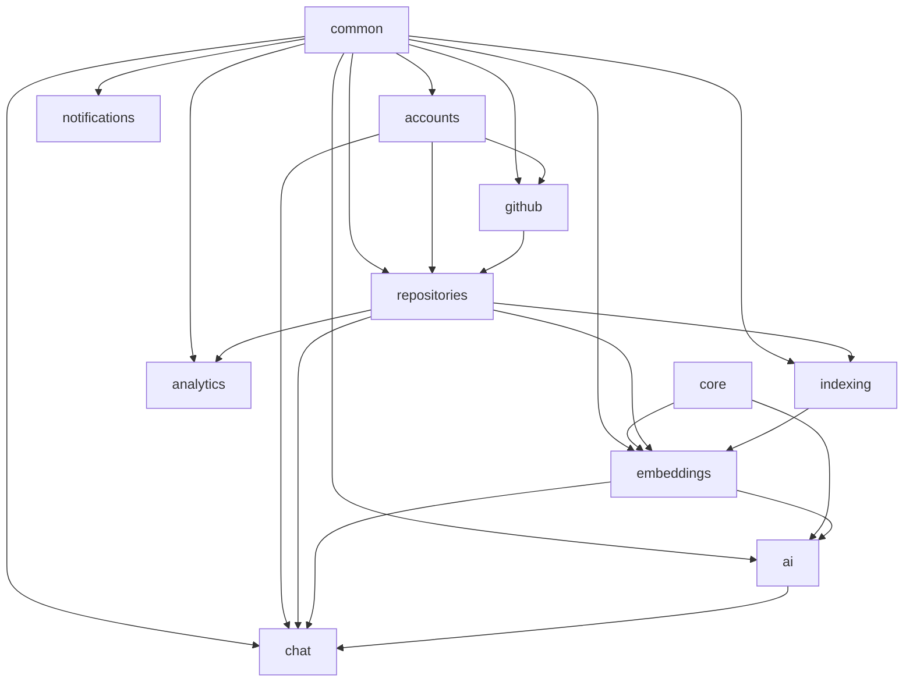

# CodePilot AI - Backend Modules Design

## Module Overview

```
codepilot/
├── config/              # Project configuration
│   ├── settings/
│   │   ├── base.py
│   │   ├── development.py
│   │   └── production.py
│   ├── urls.py
│   ├── wsgi.py
│   ├── asgi.py
│   └── celery.py
│
├── apps/
│   ├── accounts/        # Authentication & user management
│   ├── repositories/    # Repository CRUD & file management
│   ├── indexing/        # Code parsing, chunking, processing
│   ├── embeddings/      # Vector generation & search
│   ├── chat/            # Conversations & messages
│   ├── ai/             # LLM integration & prompts
│   ├── github/         # GitHub OAuth & API integration
│   ├── analytics/      # Metrics & usage tracking
│   ├── notifications/  # In-app & email notifications
│   ├── common/         # Shared utilities & base classes
│   └── core/           # Core domain logic & interfaces
│
├── manage.py
├── requirements/
│   ├── base.txt
│   ├── development.txt
│   └── production.txt
└── tests/
```

---

## App: accounts

**Responsibility:** User authentication, registration, profile management, password management.

### Components
```
accounts/
├── __init__.py
├── admin.py              # Django admin registration
├── apps.py               # App configuration
├── models.py             # User, Profile models
├── serializers.py        # Input/output serialization
├── views.py              # API views
├── urls.py               # URL routing
├── permissions.py        # Custom permissions
├── signals.py            # Post-save signals (create profile)
├── managers.py           # Custom user manager
├── validators.py         # Password, email validators
├── tokens.py             # JWT token utilities
├── tests/
│   ├── test_models.py
│   ├── test_views.py
│   └── test_serializers.py
└── migrations/
```

### Responsibilities
- User registration with email verification
- Login/logout with JWT tokens
- Token refresh mechanism
- Password change and reset
- Profile CRUD operations
- User settings management
- Account deactivation

### Key Models
- `User` (extends AbstractBaseUser)
- `Profile` (OneToOne with User)

### Key Endpoints
- POST /auth/register
- POST /auth/login
- POST /auth/logout
- POST /auth/refresh
- POST /auth/password/change
- POST /auth/password/reset
- GET/PATCH /users/me

---

## App: repositories

**Responsibility:** Repository CRUD, file management, branch tracking, status management.

### Components
```
repositories/
├── __init__.py
├── admin.py
├── apps.py
├── models.py             # Repository, RepositoryFile, Branch
├── serializers.py        # Repo serializers with nested relations
├── views.py              # ViewSets for CRUD
├── urls.py
├── permissions.py        # IsRepositoryOwner
├── filters.py            # Status, language filters
├── services.py           # Business logic layer
├── validators.py         # URL validation, size limits
├── tests/
│   ├── test_models.py
│   ├── test_views.py
│   └── test_services.py
└── migrations/
```

### Responsibilities
- Create repositories (from GitHub or upload)
- List/filter/sort repositories
- Repository detail with stats
- Delete repository (cascade cleanup)
- File browser (tree navigation)
- File content retrieval
- Branch management
- Status tracking (pending → indexing → ready → failed)

### Key Models
- `Repository`
- `RepositoryFile`
- `Branch`

### Key Endpoints
- GET/POST /repositories
- GET/DELETE /repositories/{id}
- POST /repositories/{id}/reindex
- GET /repositories/{id}/files
- GET /repositories/{id}/files/{file_id}/content

---

## App: indexing

**Responsibility:** Repository parsing, code chunking, file processing, job tracking.

### Components
```
indexing/
├── __init__.py
├── admin.py
├── apps.py
├── models.py             # IndexingJob, IndexingLog, CodeChunk
├── serializers.py
├── views.py              # Job status endpoints
├── urls.py
├── tasks.py              # Celery tasks
├── services/
│   ├── __init__.py
│   ├── parser.py         # File tree parsing
│   ├── chunker.py        # Code chunking logic
│   ├── language_detector.py
│   ├── file_filter.py    # Exclusion rules
│   └── metadata_extractor.py
├── constants.py          # Excluded dirs, extensions, limits
├── tests/
│   ├── test_chunker.py
│   ├── test_parser.py
│   └── test_tasks.py
└── migrations/
```

### Responsibilities
- Parse repository file trees
- Apply file/directory exclusion rules
- Detect binary files
- Detect programming languages
- Chunk code (AST-based + sliding window)
- Extract metadata (function names, classes, imports)
- Track indexing job progress
- Handle incremental re-indexing
- Job error handling and retry

### Key Models
- `CodeChunk`
- `IndexingJob`
- `IndexingLog`

### Celery Tasks
- `index_repository_task`
- `reindex_repository_task`
- `incremental_index_task`
- `cleanup_temp_files_task`

---

## App: embeddings

**Responsibility:** Vector embedding generation, storage, similarity search.

### Components
```
embeddings/
├── __init__.py
├── admin.py
├── apps.py
├── models.py             # Embedding model with pgvector
├── serializers.py
├── views.py              # Search endpoint
├── urls.py
├── services/
│   ├── __init__.py
│   ├── generator.py      # Embedding generation
│   ├── search.py         # Vector similarity search
│   └── reranker.py       # Result re-ranking
├── tasks.py              # Batch embedding generation
├── tests/
│   ├── test_generator.py
│   ├── test_search.py
│   └── test_models.py
└── migrations/
```

### Responsibilities
- Generate embeddings using Sentence Transformers
- Batch processing for efficiency
- Store embeddings in pgvector
- Perform similarity search (cosine distance)
- Re-rank results for relevance
- Manage embedding model versions
- Handle model hot-swapping

### Key Models
- `Embedding`

### Key Endpoints
- POST /search (semantic search)

---

## App: chat

**Responsibility:** Conversation management, message storage, chat orchestration.

### Components
```
chat/
├── __init__.py
├── admin.py
├── apps.py
├── models.py             # Conversation, Message
├── serializers.py
├── views.py              # Conversation & message CRUD
├── urls.py
├── permissions.py        # IsConversationOwner
├── services.py           # Chat orchestration
├── consumers.py          # WebSocket consumer for streaming
├── routing.py            # WebSocket URL routing
├── tests/
│   ├── test_models.py
│   ├── test_views.py
│   └── test_services.py
└── migrations/
```

### Responsibilities
- Create/list/archive conversations
- Store messages (user and assistant)
- Orchestrate RAG pipeline for responses
- Stream responses via WebSocket/SSE
- Manage conversation memory/context
- Track token usage
- Auto-generate conversation titles

### Key Models
- `Conversation`
- `Message`

### Key Endpoints
- GET/POST /conversations
- GET/DELETE /conversations/{id}
- GET/POST /conversations/{id}/messages

---

## App: ai

**Responsibility:** LLM provider abstraction, prompt management, AI feature implementations.

### Components
```
ai/
├── __init__.py
├── apps.py
├── views.py              # AI feature endpoints
├── urls.py
├── serializers.py
├── services/
│   ├── __init__.py
│   ├── llm_provider.py   # Abstract LLM interface
│   ├── openai_provider.py
│   ├── ollama_provider.py
│   ├── huggingface_provider.py
│   ├── prompt_builder.py  # Prompt construction
│   ├── rag_pipeline.py    # RAG orchestration
│   ├── doc_generator.py   # Documentation generation
│   ├── test_generator.py  # Unit test generation
│   ├── bug_detector.py    # Bug detection
│   ├── code_explainer.py  # Code explanation
│   └── pr_reviewer.py     # PR review
├── prompts/
│   ├── system.py          # System prompt templates
│   ├── explain.py         # Explanation prompts
│   ├── docs.py            # Documentation prompts
│   ├── tests.py           # Test generation prompts
│   ├── bugs.py            # Bug detection prompts
│   └── review.py          # Code review prompts
├── tasks.py               # Async AI tasks
├── tests/
│   ├── test_providers.py
│   ├── test_rag.py
│   └── test_prompts.py
└── migrations/
```

### Responsibilities
- Abstract LLM provider interface (OpenAI, Ollama, HuggingFace)
- Construct prompts with context and history
- Execute RAG pipeline (retrieve → augment → generate)
- Generate documentation
- Generate unit tests
- Detect bugs
- Explain code
- Review pull requests
- Handle streaming responses
- Token counting and budget management
- Response post-processing

### Key Endpoints
- POST /ai/explain
- POST /ai/generate-docs
- POST /ai/generate-tests
- POST /ai/detect-bugs
- POST /ai/review-pr

---

## App: github

**Responsibility:** GitHub OAuth, API integration, repository cloning, PR fetching.

### Components
```
github/
├── __init__.py
├── admin.py
├── apps.py
├── models.py             # GitHubConnection, PullRequest
├── serializers.py
├── views.py              # OAuth flow, repo listing
├── urls.py
├── services/
│   ├── __init__.py
│   ├── oauth.py          # OAuth flow handling
│   ├── api_client.py     # GitHub API wrapper
│   ├── repo_cloner.py    # Repository cloning
│   └── pr_fetcher.py     # PR diff fetching
├── tasks.py              # Async GitHub operations
├── webhooks.py           # GitHub webhook handlers
├── tests/
│   ├── test_oauth.py
│   ├── test_api_client.py
│   └── test_cloner.py
└── migrations/
```

### Responsibilities
- GitHub OAuth flow (authorize, callback, token storage)
- List user's GitHub repositories
- Clone repositories (full and sparse)
- Fetch PR diffs
- Handle GitHub webhooks (push, PR events)
- Token encryption/decryption
- Rate limit handling for GitHub API
- Repository permission verification

### Key Models
- `GitHubConnection`
- `PullRequest`

### Key Endpoints
- GET /auth/github (initiate OAuth)
- POST /auth/github/callback
- GET /github/repos
- DELETE /github/disconnect

---

## App: analytics

**Responsibility:** Repository metrics, usage tracking, statistical aggregation.

### Components
```
analytics/
├── __init__.py
├── admin.py
├── apps.py
├── models.py             # RepoMetrics, UsageLog
├── serializers.py
├── views.py              # Analytics endpoints
├── urls.py
├── services/
│   ├── __init__.py
│   ├── metrics_calculator.py   # Code metrics
│   ├── usage_tracker.py        # Action logging
│   └── aggregator.py           # Statistical aggregation
├── tasks.py              # Periodic metric calculation
├── tests/
│   ├── test_metrics.py
│   └── test_aggregator.py
└── migrations/
```

### Responsibilities
- Calculate repository metrics (complexity, coverage, lines)
- Track user actions (searches, chats, imports)
- Aggregate statistics over time
- Language breakdown calculation
- Embedding coverage tracking
- Indexing history
- Chat usage statistics
- Generate periodic reports (Celery Beat)

### Key Models
- `RepoMetrics`
- `UsageLog`

### Key Endpoints
- GET /repositories/{id}/analytics

---

## App: notifications

**Responsibility:** In-app notifications and email delivery.

### Components
```
notifications/
├── __init__.py
├── admin.py
├── apps.py
├── models.py             # Notification
├── serializers.py
├── views.py              # Notification CRUD
├── urls.py
├── services/
│   ├── __init__.py
│   ├── notifier.py       # Notification dispatch
│   └── email_service.py  # Email sending
├── consumers.py          # WebSocket for real-time
├── tasks.py              # Async email sending
├── templates/
│   └── emails/
│       ├── welcome.html
│       ├── repo_ready.html
│       └── password_reset.html
├── tests/
└── migrations/
```

### Responsibilities
- Create in-app notifications
- Mark notifications as read
- Send email notifications (async via Celery)
- Real-time notification delivery (WebSocket)
- Notification preferences per user
- Email templates

---

## App: common

**Responsibility:** Shared utilities, base classes, mixins, and constants used across all apps.

### Components
```
common/
├── __init__.py
├── models.py             # BaseModel (with created_at, updated_at)
├── serializers.py        # Base serializers, error formatting
├── permissions.py        # Shared permission classes
├── pagination.py         # Standard pagination classes
├── exceptions.py         # Custom exception classes
├── middleware.py         # Logging, timing middleware
├── mixins.py             # ViewSet mixins
├── utils.py              # Utility functions
├── validators.py         # Shared validators
├── constants.py          # App-wide constants
└── decorators.py         # Custom decorators
```

### Responsibilities
- Abstract base model with timestamps and UUID
- Standard pagination configuration
- Custom exception handler (consistent error format)
- Request logging middleware
- Rate limiting middleware
- Shared validators (UUID, URL)
- Utility functions (hashing, encoding)
- Common decorators (timing, caching)

---

## App: core

**Responsibility:** Core domain interfaces and service contracts that other apps depend on.

### Components
```
core/
├── __init__.py
├── interfaces/
│   ├── __init__.py
│   ├── llm_interface.py      # Abstract LLM provider
│   ├── embedding_interface.py # Abstract embedding service
│   ├── storage_interface.py   # Abstract file storage
│   └── search_interface.py    # Abstract search service
├── events.py                  # Domain events
└── enums.py                   # Shared enums (Status, Role, etc.)
```

### Responsibilities
- Define interfaces that apps implement
- Domain event definitions
- Shared enums and value objects
- Dependency inversion — higher-level apps depend on core interfaces

---

## Inter-App Dependencies



### Dependency Rules
1. `common` and `core` have no dependencies on other apps
2. All apps may depend on `common` and `core`
3. No circular dependencies between apps
4. Communication between apps via services, never direct model imports across boundaries
5. Use Django signals for decoupled cross-app notifications
