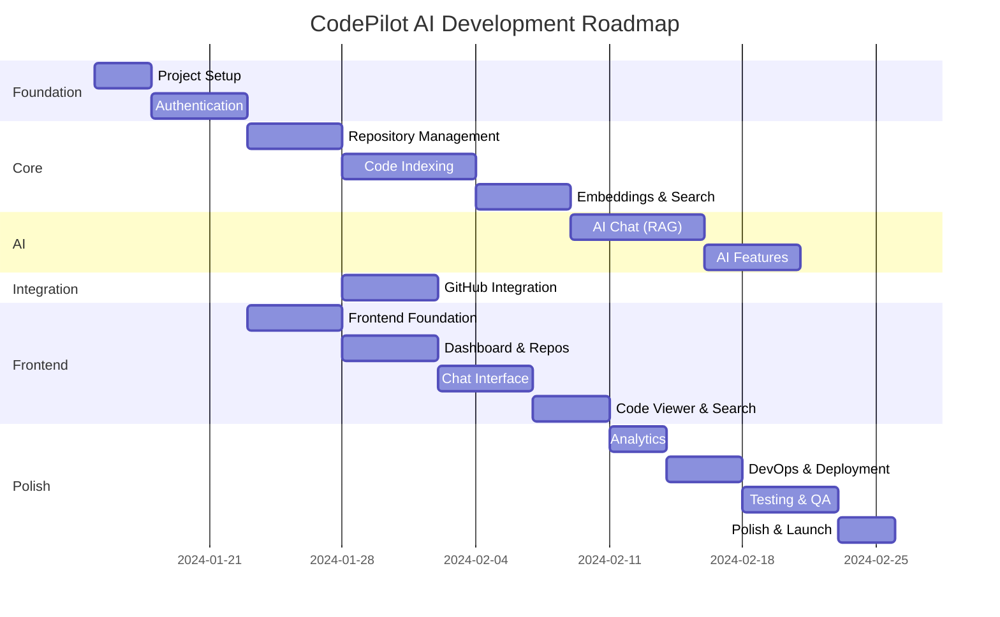

# CodePilot AI - Project Roadmap

## Milestone Overview

---

## Milestone 1: Project Setup

**Duration:** 3 days  
**Difficulty:** Low  
**Dependencies:** None  

### Deliverables
- Django project scaffold with app structure
- React project with Vite + TypeScript
- Docker compose for local development
- PostgreSQL + pgvector + Redis configured
- CI pipeline (linting, type checking)
- Git repository with branch strategy
- Documentation structure

### Acceptance Criteria
- [ ] `docker-compose up` starts all services
- [ ] Django admin accessible at /admin
- [ ] React dev server running on port 5173
- [ ] PostgreSQL with pgvector extension enabled
- [ ] Redis connectivity confirmed
- [ ] CI pipeline runs on push
- [ ] All linters passing

---

## Milestone 2: Authentication

**Duration:** 5 days  
**Difficulty:** Medium  
**Dependencies:** Milestone 1  

### Deliverables
- User model with custom manager
- Registration with email validation
- Login with JWT tokens
- Token refresh mechanism
- Password change
- Profile model and CRUD
- Auth middleware
- Frontend auth pages (login, register)
- Protected route wrapper
- Auth context and token management

### Acceptance Criteria
- [ ] User can register with email/password
- [ ] User can login and receive JWT tokens
- [ ] Access token expires after 15 minutes
- [ ] Refresh token rotates on use
- [ ] Protected endpoints return 401 without token
- [ ] Frontend stores tokens securely
- [ ] Login/Register pages functional with validation
- [ ] Password change works
- [ ] Profile update works

---

## Milestone 3: Repository Management

**Duration:** 5 days  
**Difficulty:** Medium  
**Dependencies:** Milestone 2  

### Deliverables
- Repository model with status machine
- Repository CRUD endpoints
- File upload handling (zip/tar)
- Repository file model and storage
- File browser API
- Repository list/detail pages
- Import page (upload flow)
- Repository status indicators

### Acceptance Criteria
- [ ] User can create repository via upload
- [ ] Repository status transitions work (pending → indexing → ready)
- [ ] File upload validates type and size
- [ ] Repository list filters by status
- [ ] File browser returns directory tree
- [ ] Repository deletion cascades correctly
- [ ] Frontend shows repository list with status badges
- [ ] Import page handles file upload with progress

---

## Milestone 4: Code Indexing

**Duration:** 7 days  
**Difficulty:** High  
**Dependencies:** Milestone 3  

### Deliverables
- File parsing service (exclusion rules, binary detection)
- Language detection
- AST-based code chunking (Python, JavaScript, TypeScript)
- Sliding window fallback chunking
- Metadata extraction
- Celery task for indexing
- Indexing job model with progress tracking
- Incremental re-indexing

### Acceptance Criteria
- [ ] Binary files excluded from processing
- [ ] node_modules and build directories skipped
- [ ] Python functions extracted as individual chunks
- [ ] JavaScript/TypeScript functions extracted
- [ ] Sliding window works for unsupported languages
- [ ] Metadata includes function names, line numbers
- [ ] Celery task reports progress correctly
- [ ] Job failure doesn't corrupt repository state
- [ ] Re-indexing only processes changed files

---

## Milestone 5: Embeddings & Search

**Duration:** 5 days  
**Difficulty:** High  
**Dependencies:** Milestone 4  

### Deliverables
- Sentence Transformers integration
- Embedding generation service
- Batch embedding processing
- pgvector storage and HNSW index
- Similarity search service
- Search API endpoint
- Context augmentation for embeddings
- Search result re-ranking

### Acceptance Criteria
- [ ] Embeddings generated with correct dimensions (384)
- [ ] Embeddings stored in pgvector
- [ ] HNSW index created and used
- [ ] Similarity search returns relevant results
- [ ] Search scoped to specific repository
- [ ] Results include file path, line numbers, score
- [ ] Search completes in < 1 second for 10K chunks
- [ ] Batch processing handles large repos efficiently

---

## Milestone 6: AI Chat (RAG)

**Duration:** 7 days  
**Difficulty:** High  
**Dependencies:** Milestone 5  

### Deliverables
- LLM provider abstraction (OpenAI, Ollama)
- RAG pipeline (retrieve → augment → generate)
- Prompt construction with context and history
- Conversation and message models
- Chat API endpoints
- Streaming responses (SSE)
- Conversation memory management
- Token counting and budget management

### Acceptance Criteria
- [ ] Chat messages trigger RAG pipeline
- [ ] Relevant code chunks retrieved for context
- [ ] LLM generates contextual response
- [ ] Responses include source references
- [ ] Streaming works via SSE
- [ ] Conversation history maintained
- [ ] Multiple LLM providers supported
- [ ] Token budget respected
- [ ] Follow-up questions maintain context

---

## Milestone 7: AI Features

**Duration:** 5 days  
**Difficulty:** Medium  
**Dependencies:** Milestone 6  

### Deliverables
- Code explanation feature
- Documentation generation
- Unit test generation
- Bug detection
- Prompt templates for each feature
- Feature-specific API endpoints
- Response formatting

### Acceptance Criteria
- [ ] Code explanation produces clear descriptions
- [ ] Doc generation outputs valid markdown
- [ ] Test generation produces runnable tests
- [ ] Bug detection identifies common issues
- [ ] All features use repository context
- [ ] Responses properly formatted with code blocks
- [ ] Rate limiting per feature

---

## Milestone 8: GitHub Integration

**Duration:** 5 days  
**Difficulty:** Medium  
**Dependencies:** Milestone 3  

### Deliverables
- GitHub OAuth flow
- GitHub token encrypted storage
- Repository listing from GitHub
- Repository cloning service
- PR diff fetching
- AI-powered PR review
- Webhook handler (push events)

### Acceptance Criteria
- [ ] GitHub OAuth connects account
- [ ] User's GitHub repos listed
- [ ] Repository can be imported from GitHub
- [ ] Clone uses authenticated access for private repos
- [ ] PR diffs fetched correctly
- [ ] AI review generates meaningful feedback
- [ ] GitHub token stored encrypted
- [ ] OAuth can be disconnected cleanly

---

## Milestone 9: Frontend Foundation

**Duration:** 5 days  
**Difficulty:** Medium  
**Dependencies:** Milestone 2  

### Deliverables
- App layout (sidebar, navbar, main content)
- ShadCN UI component setup
- Theme system (dark/light mode)
- Routing structure
- API client with interceptors
- React Query setup
- Toast notifications
- Loading states and skeletons
- Error boundaries
- Responsive layout

### Acceptance Criteria
- [ ] Layout renders correctly on all breakpoints
- [ ] Dark mode toggles smoothly
- [ ] Navigation works between all routes
- [ ] API client handles auth tokens
- [ ] Loading states shown during data fetching
- [ ] Error states displayed gracefully
- [ ] Toast notifications work
- [ ] Keyboard navigation functional

---

## Milestone 10: Dashboard & Repository Pages

**Duration:** 5 days  
**Difficulty:** Medium  
**Dependencies:** Milestone 9, Milestone 3  

### Deliverables
- Dashboard page (stats, repo list, recent activity)
- Repository list page with filters
- Repository detail page
- Repository import page (GitHub + upload)
- File browser component
- Status badges and progress indicators
- Repository settings/delete

### Acceptance Criteria
- [ ] Dashboard shows aggregated stats
- [ ] Repository list filters and sorts
- [ ] Import from GitHub shows repo picker
- [ ] Upload flow handles drag-and-drop
- [ ] File browser navigates directories
- [ ] Indexing progress shown in real-time
- [ ] Delete confirmation dialog works

---

## Milestone 11: Chat Interface

**Duration:** 5 days  
**Difficulty:** Medium  
**Dependencies:** Milestone 10, Milestone 6  

### Deliverables
- Chat page layout
- Conversation list sidebar
- Message list with bubbles
- Chat input with send
- Streaming message display
- Code blocks with syntax highlighting
- Source reference links
- New conversation creation
- Repository selector for context

### Acceptance Criteria
- [ ] Messages display correctly (user + assistant)
- [ ] Streaming tokens appear in real-time
- [ ] Code blocks have syntax highlighting
- [ ] Source references link to file viewer
- [ ] Conversation list shows history
- [ ] New conversations can be started
- [ ] Input supports keyboard shortcuts
- [ ] Mobile layout works

---

## Milestone 12: Code Viewer & Search

**Duration:** 4 days  
**Difficulty:** Medium  
**Dependencies:** Milestone 11, Milestone 5  

### Deliverables
- Monaco Editor integration
- File content display with line numbers
- Syntax highlighting
- Code chunk indicators
- AI action buttons (explain, docs, tests, bugs)
- Semantic search page
- Search input with filters
- Search results display

### Acceptance Criteria
- [ ] Monaco Editor renders code correctly
- [ ] Line numbers clickable
- [ ] Chunk boundaries visible
- [ ] AI actions trigger correct features
- [ ] Search returns results with relevance scores
- [ ] Search filters by language/type
- [ ] Results link to code viewer
- [ ] Search performance acceptable

---

## Milestone 13: Analytics

**Duration:** 3 days  
**Difficulty:** Low  
**Dependencies:** Milestone 12  

### Deliverables
- Repository analytics page
- Language breakdown chart
- Code complexity metrics display
- Indexing history table
- Chat usage statistics
- Metric calculation service (Celery Beat)

### Acceptance Criteria
- [ ] Language pie chart renders correctly
- [ ] Complexity metrics calculated and displayed
- [ ] Indexing history shows all jobs
- [ ] Chat usage stats accurate
- [ ] Metrics refresh periodically
- [ ] Charts responsive on mobile

---

## Milestone 14: DevOps & Deployment

**Duration:** 4 days  
**Difficulty:** Medium  
**Dependencies:** Milestone 13  

### Deliverables
- Production Docker images
- Railway/Render deployment configuration
- Vercel frontend deployment
- Neon PostgreSQL setup
- Upstash Redis setup
- Environment variable management
- Health check endpoints
- Sentry error tracking integration
- Production logging

### Acceptance Criteria
- [ ] Backend deploys to Railway/Render
- [ ] Frontend deploys to Vercel
- [ ] Database migrations run automatically
- [ ] Health checks passing
- [ ] Error tracking operational
- [ ] SSL/TLS configured
- [ ] Environment variables secured
- [ ] CORS configured for production

---

## Milestone 15: Testing & QA

**Duration:** 5 days  
**Difficulty:** Medium  
**Dependencies:** Milestone 14  

### Deliverables
- Backend unit tests (80% coverage)
- Frontend component tests
- API integration tests
- E2E tests (critical paths)
- Performance benchmarks
- Security audit
- Accessibility review

### Acceptance Criteria
- [ ] Backend test coverage > 80%
- [ ] Frontend test coverage > 75%
- [ ] All E2E critical paths passing
- [ ] API response times within targets
- [ ] No critical security vulnerabilities
- [ ] WCAG 2.1 AA compliance for key flows
- [ ] Load test passes for 100 concurrent users

---

## Milestone 16: Polish & Launch

**Duration:** 3 days  
**Difficulty:** Low  
**Dependencies:** Milestone 15  

### Deliverables
- Landing page finalization
- Onboarding flow
- Error messages refined
- Loading states polished
- Documentation complete
- README with setup instructions
- Demo repository pre-loaded
- Performance optimizations

### Acceptance Criteria
- [ ] Landing page looks professional
- [ ] New user can onboard in < 5 minutes
- [ ] All error messages actionable
- [ ] No broken UI states
- [ ] README covers local setup
- [ ] Demo works end-to-end
- [ ] Lighthouse score > 90
- [ ] Bundle size optimized

---

## Total Estimated Timeline

| Phase | Duration | Cumulative |
|---|---|---|
| Project Setup | 3 days | Week 1 |
| Authentication | 5 days | Week 1-2 |
| Repository Management | 5 days | Week 2-3 |
| Code Indexing | 7 days | Week 3-4 |
| Embeddings & Search | 5 days | Week 4-5 |
| AI Chat (RAG) | 7 days | Week 5-6 |
| AI Features | 5 days | Week 6-7 |
| GitHub Integration | 5 days | Week 4-5 (parallel) |
| Frontend Foundation | 5 days | Week 2-3 (parallel) |
| Dashboard & Repos | 5 days | Week 3-4 (parallel) |
| Chat Interface | 5 days | Week 6-7 (parallel) |
| Code Viewer & Search | 4 days | Week 7-8 |
| Analytics | 3 days | Week 8 |
| DevOps & Deployment | 4 days | Week 8-9 |
| Testing & QA | 5 days | Week 9-10 |
| Polish & Launch | 3 days | Week 10 |

**Total: ~10-12 weeks** (with parallel frontend/backend work)
